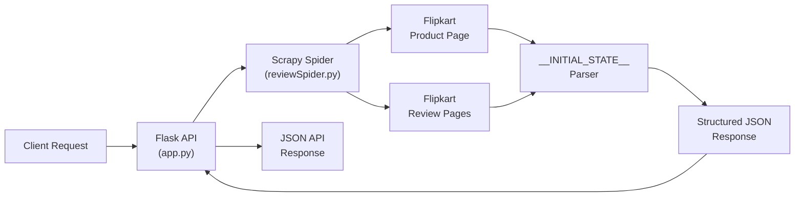

<div align="center">

# 🛒 Flipkart Review API

**A high-performance REST API & CLI tool to scrape product reviews, ratings, and pricing metadata from Flipkart.**

[](https://www.python.org/)
[](https://flask.palletsprojects.com/)
[](https://scrapy.org/)
[](#-docker)
[](LICENSE)

---

Extract structured review data from any Flipkart product — single page, multi-page, or full catalog scrapes.  
Auto-bootstraps on **Windows**, **macOS**, and **Linux**. Just run `python run.py`.

[Quick Start](#-quick-start) · [API Reference](#-api-reference) · [CLI Usage](#-cli-usage) · [Docker](#-docker) · [Architecture](#-architecture)

</div>

---

## ✨ Features

| Feature | Description |
|---|---|
| 🔗 **Smart URL Routing** | Accepts both product (`/p/`) and review (`/product-reviews/`) URLs — auto-detects and routes |
| 📄 **Flexible Pagination** | Single page, multi-page (`max_pages=N`), or exhaustive (`page=all`) scraping |
| 🔀 **Multi-Sort Deduplication** | Crawls across all Flipkart sort filters (Most Helpful, Most Recent, Negative First, Positive First) with built-in deduplication |
| 💰 **Price Extraction** | Extracts product pricing from structured data, JSON-LD, or DOM fallback |
| ⭐ **Rating Analytics** | Returns average rating, total ratings/reviews count, and full 5→1 star distribution histogram |
| 🧩 **Hydration-State Parser** | Parses Flipkart's React `__INITIAL_STATE__` for resilient, XPath-free extraction |
| 🐳 **Docker Ready** | Production `Dockerfile` + `docker-compose.yml` with health checks |
| 🖥️ **Cross-Platform** | Auto-setup scripts for Linux, macOS, Windows (CMD & PowerShell) |
| 🧪 **Test Suite** | Unit + integration tests for spider logic and Flask endpoints |

---

## 🚀 Quick Start

### Prerequisites

- **Python 3.9+** — [Download](https://www.python.org/downloads/)

> [!NOTE]
> All dependencies are installed automatically on first run. No manual `pip install` needed.

### One-Command Launch

```bash
python run.py
```

This will:
1. Create a virtual environment (`.venv/`)
2. Install all dependencies from `requirements.txt`
3. Start the API server on `http://0.0.0.0:5000`

### Platform-Specific Launchers

| Platform | Command |
|---|---|
| 🐧 Linux / 🍎 macOS | `./run.sh` |
| 🪟 Windows (CMD) | `run.bat` |
| 🪟 Windows (PowerShell) | `.\run.ps1` |
| 🐳 Docker | `docker compose up --build` |

---

## 📡 API Reference

Once the server is running, the API is available at `http://localhost:5000`.

### Endpoints

| Method | Endpoint | Description |
|---|---|---|
| `GET` | `/` | API metadata and usage instructions |
| `GET` | `/health` | Health check (`{"status": "healthy"}`) |
| `GET` | `/v1.0/reviews` | Scrape reviews for a Flipkart product |

### Query Parameters

| Parameter | Type | Required | Default | Description |
|---|---|---|---|---|
| `url` | `string` | ✅ | — | Flipkart product or review page URL |
| `page` | `int \| "all"` | ❌ | `1` | Page number to scrape, or `"all"` for every page |
| `max_pages` | `int` | ❌ | — | Maximum number of pages to scrape |

### Request Examples

**Single page of reviews:**
```bash
curl "http://localhost:5000/v1.0/reviews?page=1&url=https://www.flipkart.com/product-name/p/itm123"
```

**First 5 pages:**
```bash
curl "http://localhost:5000/v1.0/reviews?max_pages=5&url=https://www.flipkart.com/product-name/p/itm123"
```

**All reviews (exhaustive scrape):**
```bash
curl "http://localhost:5000/v1.0/reviews?page=all&url=https://www.flipkart.com/product-name/p/itm123"
```

**Health check:**
```bash
curl http://localhost:5000/health
```

### Response Format

The API returns a JSON array with three types of objects:

<details>
<summary><b>📦 Product Metadata</b> — Price and source URL</summary>

```json
{
  "product_price": "₹9999",
  "requested_url": "https://www.flipkart.com/..."
}
```

</details>

<details>
<summary><b>📊 Review Summary</b> — Aggregate rating statistics</summary>

```json
{
  "review_title": "Product Name",
  "avg_rating": "4.4",
  "total_ratings": "3,64,537 Ratings &",
  "total_reviews": "24,907 Reviews",
  "total_pages": "Page 1 of 2,491",
  "5": "2,50,327",
  "4": "67,635",
  "3": "22,835",
  "2": "7,656",
  "1": "16,084"
}
```

</details>

<details>
<summary><b>💬 Individual Review</b> — Full review data (repeated per review)</summary>

```json
{
  "review_score": "5",
  "review_title": "Brilliant",
  "review_content": "The UI is super smooth and performs really well...",
  "reviewer_name": "Reviewer Name",
  "reviewer_location": ", City, State",
  "reviewer_date": "Jan 2025",
  "permalink": "/reviews/permalink",
  "certified_buyer": true,
  "upvote": "6836",
  "downvote": "1292"
}
```

</details>

### HTTP Status Codes

| Code | Meaning |
|---|---|
| `200` | Success — reviews returned |
| `400` | Missing required `url` parameter |
| `502` | Scraper execution failed |
| `504` | Scraper timed out |
| `500` | Internal server error |

---

## 🖥️ CLI Usage

The spider can be run directly via the CLI for offline scraping to JSON files.

**Scrape a single page:**
```bash
python run.py crawl review -O output.json -a page=1 -a url="https://www.flipkart.com/product-name/p/itm123"
```

**Scrape first 10 pages:**
```bash
python run.py crawl review -O output.json -a page=1 -a max_pages=10 -a url="https://www.flipkart.com/product-name/p/itm123"
```

**Scrape all reviews:**
```bash
python run.py crawl review -O output.json -a page=all -a url="https://www.flipkart.com/product-name/p/itm123"
```

**Sort by most recent:**
```bash
python run.py crawl review -O output.json -a page=1 -a sort=MOST_RECENT -a url="https://www.flipkart.com/product-name/p/itm123"
```

> [!TIP]
> Available sort options: `MOST_HELPFUL`, `MOST_RECENT`, `NEGATIVE_FIRST`, `POSITIVE_FIRST`

---

## 🐳 Docker

### Using Docker Compose (Recommended)

```bash
docker compose up --build
```

The API will be available at `http://localhost:5000`.

### Using Docker Directly

```bash
# Build the image
docker build -t flipkart-review-api .

# Run the container
docker run -p 5000:5000 flipkart-review-api
```

> [!NOTE]
> The Docker image includes a built-in health check that pings `/health` every 30 seconds.

---

## 🧪 Running Tests

```bash
python run.py test
```

Or directly with `unittest`:
```bash
python -m unittest discover tests
```

---

## 🏗️ Architecture

```
flipkart-review-api/
├── app.py                          # Flask REST API server
├── run.py                          # Cross-platform auto-bootstrap runner
├── scrapy.cfg                      # Scrapy project configuration
├── requirements.txt                # Python dependencies
├── Dockerfile                      # Production container image
├── docker-compose.yml              # Docker Compose orchestration
├── Procfile                        # PaaS deployment (Heroku, Railway, etc.)
├── run.sh                          # Linux / macOS launcher
├── run.bat                         # Windows CMD launcher
├── run.ps1                         # Windows PowerShell launcher
├── reviewapi/
│   ├── __init__.py
│   ├── settings.py                 # Scrapy settings (UA, headers, retry)
│   ├── items.py                    # Scrapy item schemas
│   ├── middlewares.py              # Scrapy middleware hooks
│   ├── pipelines.py                # Scrapy item pipeline
│   └── spiders/
│       └── reviewSpider.py         # Core review extraction spider
└── tests/
    ├── test_spider.py              # Spider unit tests
    └── test_api.py                 # API integration tests
```

### How It Works



1. **Client** sends a `GET` request with a Flipkart URL
2. **Flask** validates input, spawns an isolated Scrapy subprocess
3. **Spider** detects URL type (product vs. review) and routes accordingly
4. **Parser** extracts data from Flipkart's React hydration state (`__INITIAL_STATE__`)
5. **Paginator** follows `hasMorePages` signal for multi-page scrapes with deduplication
6. **API** returns clean, structured JSON with product metadata + summary + reviews

---

## ⚙️ Configuration

### Environment Variables

| Variable | Default | Description |
|---|---|---|
| `PORT` | `5000` | Server port |
| `HOST` | `0.0.0.0` | Server bind address |
| `FLASK_DEBUG` | `false` | Enable Flask debug mode |

### Scrapy Settings

Key settings in [`reviewapi/settings.py`](reviewapi/settings.py):

| Setting | Value | Purpose |
|---|---|---|
| `DOWNLOAD_DELAY` | `1.0s` | Polite delay between requests |
| `CONCURRENT_REQUESTS` | `4` | Max parallel requests |
| `RETRY_TIMES` | `3` | Retry count for failed requests |
| `COOKIES_ENABLED` | `True` | Flipkart session handling |

---

## 🚢 Deployment

The project is deployment-ready for common PaaS providers:

| Platform | Method |
|---|---|
| **Docker** | `docker compose up --build` |
| **Heroku / Railway** | Push to Git — `Procfile` included |
| **Any VPS** | `python run.py` (auto-bootstraps) |

The `Procfile` runs:
```
web: gunicorn app:app
```

---

## 📝 License

This project is open source and available under the [MIT License](LICENSE).

---

<div align="center">

**Built with ❤️ using Python, Flask, and Scrapy**

<sub>If you found this useful, consider giving it a ⭐</sub>

</div>
